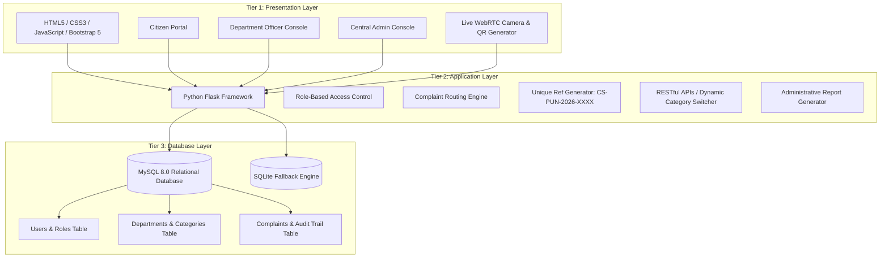

# CivicSaathi (नागरिक साथी)
## Pune City – Multi-Department Public Grievance Redressal and Management Portal

[](https://flask.palletsprojects.com/)
[](https://dev.mysql.com/doc/)
[](#system-architecture)
[](#covered-pune-departments)

---

## 🏛️ Project Overview

**CivicSaathi** is a dedicated centralized e-governance public grievance redressal and workflow management platform engineered specifically for **Pune City, Maharashtra, India**.

In a fast-growing metropolitan city with over 7.5 million citizens, residents regularly face civic infrastructure breakdowns—such as asphalt craters, water distribution pipe bursts, uncollected solid waste piles, traffic signal outages, and hazardous low-hanging electrical cables. Citizens often struggle to navigate disjointed portals, separate helplines, or physical ward offices across the Pune Municipal Corporation (PMC), Pune Traffic Police, MSEDCL, and PMPML.

**CivicSaathi** bridges this gap by providing a single digital window to register, route, track, investigate, and redress public complaints with photographic evidence and tamper-proof audit trails.

---

## 🌟 Key Functional Highlights

- **Three-Tier Web Architecture**: Strict separation of Presentation, Business Logic, and Database layers.
- **Three Distinct Role Portals**:
  1. **Citizen Portal**: Register, lodge complaints with live WebRTC camera or file upload, GPS location tagging, track live status, and print stamped Digital Acknowledgement Receipts with QR codes.
  2. **Department Officer Portal**: Department-segregated grievance queue, SLA countdowns, priority sorting, mandatory investigation remarks, and resolution proof photo uploading.
  3. **Super Administrator Console**: Pune Central Grievance Redressal oversight, city-wide statistics, interactive Chart.js analytics, department ticket re-routing/reassignment, and administrative report generation.
- **All 15 Pune Municipal & State Public Service Departments**: Complete coverage of PMC (8 departments), Pune Police & Traffic Police, MSEDCL (Mahavitaran), PMPML, RTO Pune, MPCB, Maharashtra PWD, and MahaMetro.
- **Dual Database Engine**:
  - **MySQL 8.0+ / MariaDB**: Full relational DDL schema script in `schema.sql` with foreign keys, InnoDB storage, and indexing.
  - **SQLite Zero-Config Engine**: Automatically initializes and seeds realistic Pune civic data so the project runs out-of-the-box on any machine without database configuration.

---

## 🏗️ System Architecture (Three-Tier Web Architecture)



---

## 🏢 Covered Pune City Departments & Categories

### A. Pune Municipal Corporation (PMC) - 8 Wings
1. **Road and Infrastructure Department**: Potholes, asphalt road damage, broken footpaths, dividers, missing railings.
2. **Solid Waste Management Department**: Overflowing garbage bins, unattended dumps, irregular collection, illegal dumping.
3. **Water Supply Department**: Main pipeline burst/leakage, irregular supply, low pressure, contaminated water.
4. **Drainage and Sewerage Department**: Blocked underground drainage, overflowing manholes, missing covers, monsoon waterlogging.
5. **Streetlight & Electrical Maintenance**: Non-functional streetlights, broken fixtures, exposed junction boxes.
6. **Garden and Public Spaces Department**: Broken public park equipment, damaged gardens, hazardous dead branches.
7. **Public Health and Sanitation**: Public toilet maintenance, vector control, mosquito breeding locations, hygiene violations.
8. **Encroachment & Public Property**: Footpath encroachments, unauthorized commercial stalls, public space blockades.

### B. Pune Traffic Police & State Authorities - 7 Departments
9. **Pune Police and Traffic Police**: Signal malfunctions, severe bottlenecks, illegal parking, road obstructions.
10. **Maharashtra State Electricity Distribution Co. (MSEDCL / Mahavitaran)**: Power outages, tilted poles, exposed wires, transformer sparks.
11. **PMPML Bus Transport**: Irregular bus service, damaged bus shelters, bus hygiene, driver conduct.
12. **Pune Regional Transport Office (RTO - MH-12 & MH-14)**: Auto-rickshaw overcharging, public carrier fitness, permit grievances.
13. **Maharashtra Pollution Control Board (MPCB Pune)**: River industrial effluents, air pollution, illegal waste burning, noise pollution.
14. **Maharashtra Public Works Department (PWD Pune Circle)**: State highway maintenance, government building infrastructure.
15. **Pune Metro / MahaMetro**: Station amenities, escalators, AFC gates, viaduct leakage, passenger facilities.

---

## ⚡ Quick Start: How to Run the Application

### 1. Run the Python Flask Application (Primary Recommended Option)

Make sure **Python 3.10+** is installed on your computer.

```bash
# 1. Open your terminal in the project directory
cd civicsaathi

# 2. Start the Flask application
python app.py
```

The system will automatically initialize the database, seed all 15 Pune departments, categories, sample complaints, and start the web server:

```text
=======================================================
 CivicSaathi - Pune City Grievance Redressal Portal
 Running at: http://127.0.0.1:5000
 Citizen Demo: rajesh.patil@gmail.com / pune123
 Officer Demo: officer.roads@pmc.gov.in / pune123
 Admin Demo:   admin@civicsaathi.pune.gov.in / admin123
=======================================================
```

Open your browser and navigate to: **`http://127.0.0.1:5000`**

---

### 2. Run Integration Test Suite

To verify that all routes, authentication gates, API endpoints, and receipts work with zero errors:

```bash
python test_routes.py
```

Output:
```text
[PASS] 1. Home Page: 200 OK
[PASS] 2. Track Page with Reference: 200 OK
[PASS] 3. Official Digital Acknowledgement Receipt: 200 OK
[PASS] 4. Dynamic Categories API: 200 OK (5 categories returned)
[PASS] 5. Citizen Login & Dashboard: 200 OK
[PASS] 6. Officer Login & Queue: 200 OK
[PASS] 7. Super Administrator Console: 200 OK

>>> ALL 7 CORE FUNCTIONAL TESTS PASSED FLAWLESSLY! <<<
```

---

## 🗄️ MySQL 8.0 Setup (Optional / Production Mode)

The project includes the production relational schema file in [`schema.sql`](file:///c:/Users/admin/Downloads/civicsaathi/schema.sql).

To import into MySQL 8.0:
```bash
mysql -u root -p < schema.sql
```

Then in `config.py` (or through environment variables):
```python
MYSQL_HOST = 'localhost'
MYSQL_USER = 'root'
MYSQL_PASSWORD = 'your_mysql_password'
MYSQL_DB = 'civicsaathi_pune_db'
USE_SQLITE = 'false'
```

---

## 👥 Demo Credentials & Test Accounts

| Role | Name & Department | Email Address | Password |
|---|---|---|---|
| **Citizen** | Rajesh Patil (Kothrud) | `rajesh.patil@gmail.com` | `pune123` |
| **Citizen** | Priya Deshmukh (Shivajinagar) | `priya.deshmukh@gmail.com` | `pune123` |
| **PMC Officer** | Er. Amit Kulkarni (PMC Roads) | `officer.roads@pmc.gov.in` | `pune123` |
| **PMC Officer** | Er. Prashant Joshi (PMC Water) | `officer.water@pmc.gov.in` | `pune123` |
| **Traffic Police** | Insp. Sachin More (Traffic Division) | `officer.traffic@punepolice.gov.in` | `pune123` |
| **MSEDCL Officer** | Er. Nitin Jadhav (Mahavitaran) | `officer.msedcl@mahadiscom.in` | `pune123` |
| **Central Admin** | Pune Grievance Cell Admin | `admin@civicsaathi.pune.gov.in` | `admin123` |

*(Note: The login page also features **1-Click Demo Autofill buttons** for rapid evaluation!)*

---

## 📁 Project Directory Structure

```text
civicsaathi/
├── app.py                     # Main Python Flask Three-Tier Web Application
├── config.py                  # Database & upload configurations
├── database.py                # Database connection (MySQL 8.0 & SQLite dual engine)
├── schema.sql                 # MySQL 8.0 Relational Database DDL statements
├── seed_data.py               # Pune departments, categories, officers & grievances seed script
├── test_routes.py             # Automated unit & integration test suite
├── static/
│   ├── css/
│   │   └── style.css          # Responsive municipal styling & print receipt styles
│   ├── js/
│   │   └── main.js            # Category AJAX filter, WebRTC camera, GPS, QR code
│   └── uploads/               # Photographic evidence & resolution proof images
├── templates/
│   ├── base.html              # Master layout with Pune civic navbar & footer
│   ├── index.html             # Home page with hero, quick tracker & 15 depts directory
│   ├── login.html             # Unified 3-tab login (Citizen, Officer, Admin)
│   ├── register.html          # Citizen registration with Pune wards
│   ├── track.html             # Public complaint tracker by Ref No & live timeline
│   ├── citizen/
│   │   ├── dashboard.html     # Citizen dashboard & ticket management
│   │   ├── new_complaint.html # File complaint with photo, camera & GPS tagging
│   │   └── receipt.html       # Official Digital Acknowledgement Receipt with QR & print
│   ├── officer/
│   │   ├── dashboard.html     # Department queue, SLA countdowns & priority filters
│   │   └── update_ticket.html # Investigation remarks & resolution photo uploader
│   └── admin/
│       ├── dashboard.html     # Central console with Chart.js analytics
│       ├── complaints.html    # Master registry & department re-routing
│       ├── departments.html   # Department list & statistics
│       ├── officers.html      # Officer directory & create officer
│       └── reports.html       # Administrative report generator & export
```

---

## 📜 Compliance with Project Synopsis

This system satisfies 100% of the specifications from the **Project Synopsis**:
- **Domain**: Web Application Development / E-Governance / Public Grievance Management
- **Technology**: Frontend: HTML5, CSS3, JavaScript | Backend: Python Flask | Database: MySQL 8.0+
- **Architecture**: Three-Tier Web Architecture
- **Location**: Pune City, Maharashtra, India
- **Module 1**: User Authentication & Role Management (Citizen, Officer, Admin)
- **Module 2**: Department & Complaint Management (All 15 Pune authorities & categories)
- **Module 3**: Citizen Dashboard & Tracking (Ref No, Timeline, Stamped Receipt with QR)
- **Module 4**: Department Officer & Action Management (Remarks, Status transition, Photo proof)
- **Module 5**: Administration & Reporting (Department re-routing, Chart.js, PDF/Print reports)
